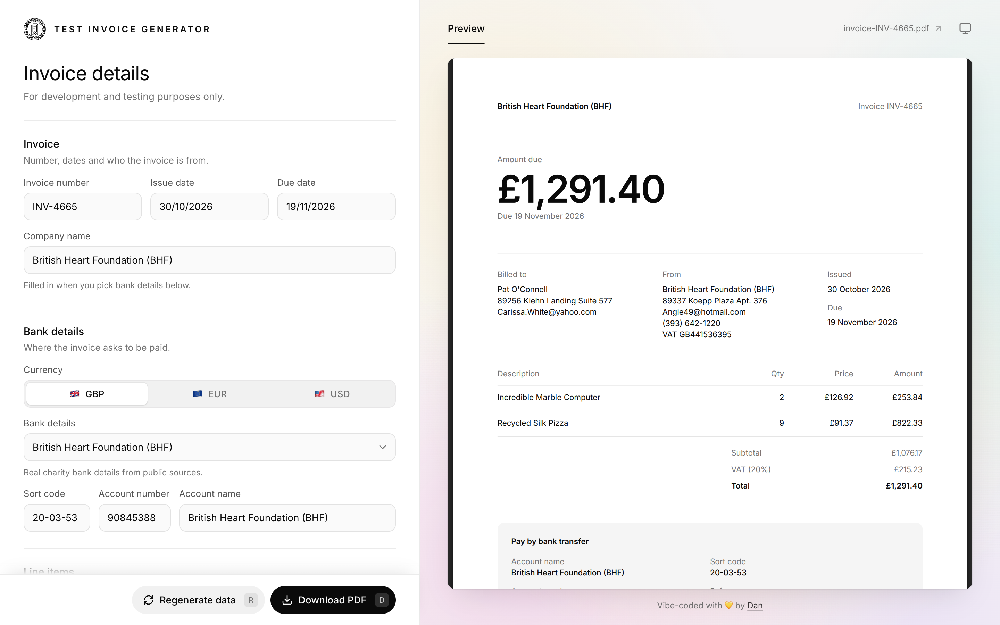

# Test Invoice Generator

> Realistic PDF invoices for testing, with random details and real bank accounts

<picture>
  <source media="(prefers-color-scheme: dark)" srcset="docs/screenshot-dark.png" />
  
</picture>

**[Open the app](https://danilqa.github.io/sample-invoice-generator/)**

Every invoice is filled with random details: the customer, addresses, line items, amounts and dates. The bank details are real, though. They belong to charities and come from public sources, so the sort codes, account numbers and IBANs pass bank validation checks.

Pick GBP, EUR or USD, then press <kbd>R</kbd> for a new invoice or <kbd>D</kbd> to download it as a PDF. Each currency gets the bank details it's paid with: a sort code and account number for GBP, an IBAN for EUR, and an IBAN with a SWIFT/BIC for USD. Everything runs in your browser, and nothing is sent anywhere.

## Use cases

- Testing invoice upload and data extraction (OCR) in accounts payable and bookkeeping apps
- Testing bill payment flows that validate the payee's bank details
- Filling demo and staging accounts with realistic bills
- Checking document parsing and AI extraction pipelines

> [!WARNING]
> Every invoice says "This is not a real invoice. Don't pay!", but the bank accounts are real. Only send payments in a sandbox, unless you mean to make a donation.

## Run locally

```sh
npm ci
npm run dev
```

## A note on the code

This project is vibe-coded, so the code is low quality.
